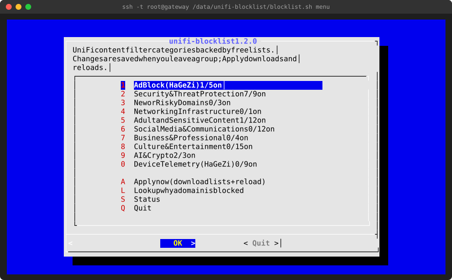
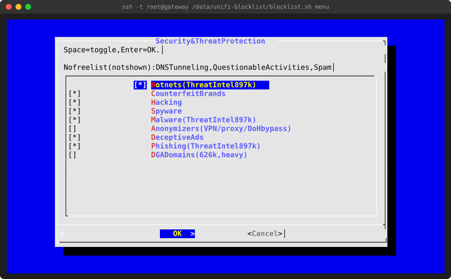
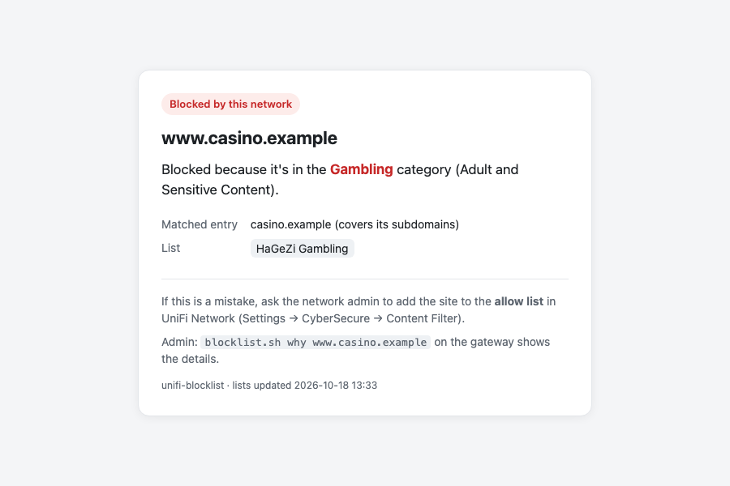

# unifi-blocklist

Category-based DNS filtering for UniFi gateways using free, open-source blocklists instead of the paid **CyberSecure Enhanced** subscription.

On UniFi OS, the detailed content-filter categories (Malware, Phishing, Gambling, Social Networks, …) are greyed out unless you pay for CyberSecure Enhanced. The free built-in **Ad Block** uses a list of about 73,000 ad hostnames that UniFi downloads to the gateway, and many of them no longer exist (see [UniFi's built-in Ad Block list](docs/unifi-ad-block-list.md)). This project replaces both with community-maintained lists, mainly [HaGeZi](https://github.com/hagezi/dns-blocklists). It loads them into **UniFi's own filtering engine**, so:

- the same category names as the greyed-out UniFi list can be switched on and off from a menu,
- the Ad Block level chosen in the menu (HaGeZi Light to Ultimate) replaces UniFi's own Ad Block list,
- the block page says which category and list blocked a site,
- blocked domains still appear in the UniFi web UI, ads as Ad Block,
- the **allow list in the UniFi UI keeps working**,
- UniFi's own files are never edited, and everything can be removed with one command,
- lists refresh automatically every 12 hours.

> [!IMPORTANT]
> This is an unofficial project and is not affiliated with or endorsed by Ubiquiti. It relies on undocumented internals of UniFi OS, which can change with any firmware update. It has only been **tested on a UniFi Cloud Gateway Ultra** (details below). Other gateways with the same engine may work but haven't been tested; the installer checks compatibility before changing anything. Use at your own risk.

## Screenshots

Main menu: one entry per UniFi CyberSecure group, with how many categories are switched on.



Inside a group: the same categories as the greyed-out UniFi list. Categories with no free list available are named at the top instead of being shown.



Block page: what a blocked site shows (here with a made-up name).



## Compatibility

| | Tested |
|---|---|
| Device | UniFi Cloud Gateway Ultra (UCG Ultra) |
| Firmware | UniFi OS 5.1.33 (`UDRULT.ipq5322.v5.1.33`) |
| UniFi Network | 10.6.106, Content Filter with Ad Block (CyberSecure, no subscription) |
| Filtering engine | UniFi CoreDNS `1.11.3-10+g74ebc1e61302` |

**May work** on other UniFi OS 4.x/5.x gateways that have the same content-filter engine, for example UCG Max, UCG Fiber, UDM / UDM Pro / UDM SE, UDR / UDR7 and UXG models. This is untested. Run the built-in check (step 4 below) to find out. It only reads, and the installer refuses to continue if it fails.

**Will not work** on gateways without UniFi OS, such as the USG and older EdgeOS-based models.

## Installation

You need a computer on the same network as the gateway and about 10 minutes.

### 1. Enable SSH on the gateway

In UniFi, go to **Settings → Control Plane → Console**, enable **SSH**, and set an SSH password. The menu location can differ slightly between UniFi OS versions; look for "SSH" in the console settings.

### 2. Set up Content Filter in UniFi

In UniFi Network, go to **Settings → CyberSecure → Content Filter**. For each network you want filtered:

| Setting | Value | Why |
|---|---|---|
| **Ad Block** | **On** | **Required.** This is what sends the network's DNS through UniFi's filter, where this project's lists are applied. Its ad list is replaced by the Ad Block level you choose in this project's menu. |
| Content filter category (Basic / Work) | Off / None (recommended) | The built-in "Basic" category also blocks many legitimate sites, such as torrent and usenet indexers. Use this project's categories instead (for example `PORNOGRAPHY`). |
| Allow list | sites that must never be blocked | Takes priority over the block lists for that domain and its subdomains (one exception: see [Troubleshooting](#troubleshooting)). |
| Block list | optional | Kept and used alongside this project's lists. |

Networks without Ad Block or a content filter are not filtered at all.

### 3. Connect to the gateway

Open a terminal (macOS/Linux: Terminal; Windows: PowerShell or Windows Terminal) and run the command below. Replace `192.168.1.1` with your gateway's IP address and log in with the SSH password from step 1:

```sh
ssh root@192.168.1.1
```

### 4. Check compatibility (optional, read-only)

```sh
curl -fsSL https://raw.githubusercontent.com/msaifuddin/unifi-blocklist/main/blocklist.sh | bash -s check
```

Every line should say `[ OK ]` and the result should be `compatible`. A `[FAIL]` line explains what's missing. The most common cause is that Ad Block isn't on yet; turn it on, wait a minute and try again.

### 5. Install

```sh
curl -fsSL https://raw.githubusercontent.com/msaifuddin/unifi-blocklist/main/install.sh | bash
```

This installs the newest release into `/data/unifi-blocklist` (a location that survives reboots and firmware updates), runs the compatibility check, downloads the default lists and starts the background services. The default categories are **Ad Block Pro, Botnets, Malware and Phishing**, about 1.1 million domains (the Threat Intelligence list behind Botnets, Malware and Phishing alone has about 900,000).

### 6. Check that it works

On the gateway:

```sh
/data/unifi-blocklist/blocklist.sh status
```

It should look like this (with your own categories), with `Applied : yes` and the watcher running:

```
Version     : 1.3.0
Categories  : ADS_PRO BOTNETS COUNTERFEIT_BRANDS CRYPTOCURRENCY
              CRYPTOMINING DECEPTIVE_ADS GAMBLING HACKING MALWARE
              PHISHING SPYWARE
Domains     : 1,099,865 + 201,729 Ad Block (downloaded 2026-10-18 12:07)
Ad Block    : selected level replaces UniFi's own list
Block page  : shows the category and list
Applied     : yes
CoreDNS     : running (pid 919559, 193 of 265 MB memory limit)
Watcher     : running
Last update : 2026-10-18 12:09 (ok)
Next update : 2026-10-19 00:13 (in 12h)
```

From any computer on a filtered network (works on Windows, macOS and Linux):

```sh
nslookup app-measurement.com 192.168.1.1
```

`app-measurement.com` is on the Ad Block lists, so it returns `0.0.0.0`. Domains blocked by the other categories return `203.0.113.250` (UniFi's block page address). A normal site such as `github.com` returns its real address.

## Choosing categories

```sh
ssh -t root@192.168.1.1 /data/unifi-blocklist/blocklist.sh menu
```

- Use the arrow keys and Enter to open a group, or press its number (`0` for the tenth group).
- Press Space to switch a category on or off, then Enter to confirm.
- Choose **Apply now** to download the lists and activate them. This takes from a few seconds to a minute. DNS then pauses while the filter loads the new lists: about 10–20 seconds for 1.3 million domains, less for smaller lists.

The same can be done without the menu:

```sh
cd /data/unifi-blocklist
./blocklist.sh categories                         # show all categories and which are on
./blocklist.sh enable gambling social_networks    # switch on (names as shown by 'categories')
./blocklist.sh disable ads_pro                    # switch off
systemctl start unifi-blocklist-update            # download and apply now
```

### Available categories

The groups and names match the CyberSecure Enhanced list in the UniFi UI. Each category is backed by a free list. Where no suitable free list exists, the category is marked **n/a** and can't be switched on.

| Group | Categories with a free list |
|---|---|
| Ad Block (HaGeZi) | Light, Normal, **Pro** (recommended), Pro++, Ultimate. Only one can be on; each level includes the one before it. |
| Security & Threat Protection | Botnets, Malware, Phishing, Counterfeit Brands, Hacking, Spyware, Anonymizers (VPN/proxy/DoH bypass), Deceptive Ads, DGA Domains |
| New or Risky Domains | Newly Registered Domains (too large for most gateways), Dynamic DNS, Badware Hosters |
| Networking Infrastructure | Redirectors (URL shorteners) |
| Adult and Sensitive Content | Pornography, Nudity, Sexuality, Adult Themes, Gambling, Drugs, Violence, Hate Speech, Weapons, Lingerie, Sex Education, Unreliable Information |
| Social Media & Communications | Social Networks, Chat, Instant Messengers, Messaging, Webmail, Translators, File Sharing, Peer To Peer, Audio/Video Streaming, Radio, File Hosting |
| Business & Professional | News and Media, Magazines, Economy and Finance, Job Search |
| Culture & Entertainment | Shopping, Ecommerce, Auctions, Dating, Gaming, Sports, Movies, Music, Blogs, Forums, Astrology, Religion, Food and Drink, Cartoons and Anime, Comic Books |
| AI & Crypto | Artificial Intelligence, Cryptocurrency, Cryptomining |
| Device Telemetry (HaGeZi) | Apple, Amazon, Samsung, LG webOS, Roku, Windows/Office, Xiaomi, Huawei, TikTok |

The full mapping of categories to lists is in [`categories.list`](categories.list).

**Size matters:** every domain uses memory, and UniFi limits the filter (CoreDNS) to about 265 MB on a UCG Ultra. 1.2 million domains use about 195 MB of that. If the filter reaches the limit, the system stops and restarts it, and DNS pauses each time. `status` shows the current use. Large lists include Threat Intelligence (897k), DGA Domains (626k), Gambling (224k) and Newly Registered Domains (3.2M). A safety limit of 1.3 million domains in total (`MAX_ENTRIES` in `blocklist.conf`) stops an oversized selection from being applied; the previous lists stay active instead.

## Everyday use

| I want to… | Do this |
|---|---|
| Find out why a site is blocked | Read the block page, or run `/data/unifi-blocklist/blocklist.sh why example.com`, or **Look up** in the menu (see below) |
| Unblock a site | Add it to the **allow list** in the UniFi UI (Content Filter). It takes effect within about 40 seconds. |
| Block an extra site | Add it to the **block list** in the UniFi UI, or to `/data/unifi-blocklist/custom-block.list` (one domain per line) and run `systemctl start unifi-blocklist-update`. |
| See what's being blocked | UniFi UI, or `tail -f /var/log/ulog/content_filtering.log` on the gateway |
| Check that everything is running | `/data/unifi-blocklist/blocklist.sh status` |
| See all commands | `/data/unifi-blocklist/blocklist.sh help` (or run it without a command) |
| Update the lists now | `systemctl start unifi-blocklist-update` (otherwise every 12 hours) |
| See which version is installed | `/data/unifi-blocklist/blocklist.sh version` (also shown by `status` and the menu) |
| Update this project | `/data/unifi-blocklist/blocklist.sh upgrade` (see [Updating](#updating)) |
| Add your own list URLs | Edit `LIST_URLS` in `/data/unifi-blocklist/blocklist.conf` |
| Keep UniFi's own Ad Block list | Set `REPLACE_UNIFI_ADBLOCK=0` in `/data/unifi-blocklist/blocklist.conf` and run `systemctl start unifi-blocklist-update`. The chosen Ad Block level then goes into the block list, next to UniFi's list. |

Ads appear in the UniFi UI as Ad Block blocks, everything else as content-filter blocks.

### Why is a site blocked?

**The block page.** A site blocked by one of the categories shows a page that says why:

- the blocked name, and the category (with its group) it's in, for example *Blocked because it's in the Gambling category (Adult and Sensitive Content)*,
- the list entry that matched, when it's a parent domain (`example-casino.com` blocks `www.example-casino.com`),
- the list it came from, for example *HaGeZi Gambling*, or the UniFi block list or `custom-block.list`,
- what to do if it's a mistake.

Notes:

- Ads blocked by Ad Block get no page: they're answered with `0.0.0.0` so they fail without a page, as ads inside other pages should.
- On HTTPS sites, the browser only shows the page on devices that trust UniFi's certificate; other devices show a certificate warning instead. The certificate is `/run/utm/lighttpd.crt` on the gateway (`scp root@192.168.1.1:/run/utm/lighttpd.crt .`); install it as a trusted root certificate on the devices where you want the page. Anyone with the gateway's private key could then impersonate any HTTPS site to those devices.
- Set `BLOCK_PAGE=0` in `blocklist.conf` and run an update to keep UniFi's own page.

**From the command line.** To see which list and category block a domain, run `why` with the domain or a pasted URL:

```console
# /data/unifi-blocklist/blocklist.sh why https://www.example-casino.com/promo
Domain      : www.example-casino.com
Lists       : example-casino.com  (hg_gambling)
Categories  : Adult and Sensitive Content: Gambling
DNS answer  : 203.0.113.250 (block page address)
Result      : blocked by the list entries above
```

- **Lists** shows the entries that match, most specific first. An entry also covers its subdomains, so `example-casino.com` blocks `www.example-casino.com`.
- **Categories** shows only the categories that are switched on. One list can back several categories: for example, the Threat Intelligence feed is behind Botnets, Malware, Phishing and Spyware, so all four are shown.
- **DNS answer** is what the filter answers right now, asked the same way a device on a filtered network asks: `0.0.0.0` means Ad Block, `203.0.113.250` one of the other categories or the UniFi UI block list.
- **Result** also covers blocks that don't come from these lists, such as UniFi's own Ad Block list when it isn't replaced, and shows any UniFi allow list entry for the domain.


## Updating

**How you find out.** Each time the lists are updated, the script also asks GitHub for the newest release of this project. That happens 5 minutes after the gateway starts, every 12 hours after that, and whenever you run an update yourself (menu **Apply**, `blocklist.sh update`). A new release is therefore noticed within about half a day. If it's newer than what's installed, `status` and the menu show:

```
Version     : 1.2.2 (update available: 1.3.0, run: blocklist.sh upgrade)
```

The same line is written to the log (`grep unifi-blocklist /var/log/messages`). Nothing is installed automatically.

**How to update.** Run:

```sh
/data/unifi-blocklist/blocklist.sh upgrade
```

It installs the newest release and keeps your settings, categories and custom domains. If you're already up to date it says so; `upgrade --force` reinstalls anyway. Versions before 1.1.0 don't have this command: run the install command from step 5 once instead.

**Install a specific version.** To install an older release (for example if a new one causes problems), or the development version:

```sh
curl -fsSL https://raw.githubusercontent.com/msaifuddin/unifi-blocklist/main/install.sh | TAG=v1.2.2 bash
curl -fsSL https://raw.githubusercontent.com/msaifuddin/unifi-blocklist/main/install.sh | BRANCH=main bash
```

All releases and their changes are listed on the [releases page](https://github.com/msaifuddin/unifi-blocklist/releases).

**Details.**
- The check is one request to `api.github.com` per list update, without any account or token.
- If GitHub can't be reached, the check is skipped. It never affects blocking or the list update.
- To turn the check off, set `UPDATE_CHECK=0` in `/data/unifi-blocklist/blocklist.conf`.

## Uninstall

```sh
/data/unifi-blocklist/blocklist.sh uninstall   # stops the services, restores UniFi's own block list, Ad Block list and block page
rm -rf /data/unifi-blocklist                   # optional: delete all files
```

## Troubleshooting

**A site or app stopped working.** The block page says which category and list blocked it (if it shows; see [Why is a site blocked?](#why-is-a-site-blocked)), and so does `blocklist.sh why DOMAIN`. Add the domain to the allow list in the UniFi UI, or switch that category off. To find the domain of something that shows no page, such as an app, look at `/var/log/ulog/content_filtering.log` on the gateway while reproducing the problem. If many sites break, choose a lower Ad Block level.

**Allowed a domain, but part of the site is still blocked.** An allow list entry also covers its subdomains, except names that a list blocks more specifically: allowing `example.com` doesn't unblock `ads.example.com` if `ads.example.com` itself is on a list. Run `blocklist.sh why` on the blocked name and add that name to the allow list too.

**Nothing is blocked.** Check that Ad Block is on for that network in the UniFi UI, then run `blocklist.sh check` and `blocklist.sh status`. Devices that use their own encrypted DNS (DNS-over-HTTPS in browsers, Android "Private DNS") bypass the gateway entirely. The **Anonymizers** category blocks most of these bypass services.

**After a firmware update.** Run `blocklist.sh status`. If the watcher or timer isn't running, run the install command from step 5 again. If `check` now fails, the firmware has changed how filtering works and this project may not work with it; `blocklist.sh uninstall` restores UniFi's own filtering.

**"Applied: NO" in status.** UniFi has just rewritten its files (for example after a settings change). The watcher re-applies the list within about 30 seconds.

**"Applied: pending" in status.** The last apply didn't finish, or CoreDNS didn't start blocking with the new list and the previous list was put back. See why with `grep unifi-blocklist /var/log/messages`. The next scheduled update tries again.

## How it works

UniFi's content filter runs a customised CoreDNS server on the gateway. DNS requests from filtered networks are redirected to it:

```
client ──DNS:53──► firewall rule DNSFILTER (networks in ipset "dnsfilter")
                        │  redirect
                        ▼
                CoreDNS 127.0.0.1:1053   (/run/utm/coredns_config.conf)
                  plugin "hostSet", one lookup table, the most specific name wins:
                    allow list     domainlist_1.list   ← UniFi UI allow list       → resolve normally
                    block list     domainlist_0.list   ← UniFi UI block list       → 203.0.113.250
                                                       + this project's categories
                    Ad Block list  /etc/utm/pre_categorized_list/*.csv
                                                       ← this project's Ad Block   → 0.0.0.0
                                                         level (UniFi's own list
                                                         when not replaced)
                        │ not blocked
                        ▼
                dnsmasq (local DNS records) ──► upstream DNS
```

Facts this project relies on (verified on the UCG Ultra):

- Everything under `/run/utm/` is generated by UniFi from the UI settings. It is rebuilt at boot and whenever content-filter settings are saved.
- `domainlist_0.list` (block) and `domainlist_1.list` (allow) are plain text, one domain per line. An entry also covers its subdomains: `example.com` blocks `www.example.com`.
- The Ad Block list is CSV (`category,host,type`). A `domain` row matches only that exact name (UniFi's own rows); a `domain_zone` row also covers subdomains (this project's rows). Without a subscription, only the `ADVERTISEMENT` rows are used.
- All three lists go into one lookup table, and the most specific matching name decides. For the same name, the allow list beats the block list, which beats Ad Block. An allowed `example.com` therefore doesn't unblock a listed `ads.example.com`.
- UniFi downloads a new Ad Block list 10 minutes after each CoreDNS start and every 24–26 hours after that, then reloads it in place. The reload briefly holds two copies of everything, so with large lists CoreDNS exceeds its memory limit (about 265 MB on a UCG Ultra) and is stopped and restarted. Details: [UniFi's built-in Ad Block list](docs/unifi-ad-block-list.md).
- CoreDNS reads these files only at start-up. UniFi's supervisor (`ubios-udapi-server`) restarts CoreDNS about 1 second after it stops, and waits a few seconds longer after several restarts in a row, so restarting it is how a new list is loaded.
- There is no way to load a new list without a pause. CoreDNS answers nothing while it reads the lists (about 10–20 seconds for 1.3 million domains on a UCG Ultra). Its `SIGUSR1` reload also starts a new process with the same pause, and the command socket (`/run/utm/coredns_command.sock`, gRPC) has no command for loading lists.
- Blocks from the block list return `203.0.113.250` / `2001:db8:1000::fa` and are logged with `"category":"INCLUSION"` in `/var/log/ulog/content_filtering.log`, which the UniFi UI reads. Ad Block returns `0.0.0.0` / `::` and is logged as `"type":"dnsAdBlock"`.
- Requests to `203.0.113.250` on ports 80 and 443 are forwarded by a UniFi firewall rule to UniFi's lighttpd on `127.0.0.1:2080` / `:20443` (`/run/utm/lighttpd.conf`). It serves every path from `/usr/share/lighttpd/www`, falling back to `index.html`. For HTTPS it creates a certificate for each visited name, signed by "UniFi SSL Certificate Authority" (`/run/utm/lighttpd.crt`, created once and kept across reboots).

What the script does (`/data/unifi-blocklist/blocklist.sh`):

1. **update** (timer, every 12 hours): downloads the lists for the enabled categories, converts them to plain domains and merges them. The Ad Block level is kept separate.
   - Each list is cached. If a download fails, or returns less than half its previous size, the cached copy is used instead.
   - All lists together must fall between `MIN_ENTRIES` and `MAX_ENTRIES` domains, otherwise they aren't applied. The lower limit only applies when downloaded lists are selected, so a few custom domains on their own are fine.
   - With nothing selected at all, only UniFi's own block list entries stay active.
   - It also checks GitHub for a newer release of this project. This only shows a notice; nothing is installed until you run `upgrade`. Set `UPDATE_CHECK=0` in `blocklist.conf` to turn the check off.
2. **apply**: writes UniFi's own block list entries, then a marker line, then the downloaded list into `domainlist_0.list`.
   - It writes the Ad Block level as a CSV in UniFi's format (keeping UniFi's rows for other categories, plus an Ad Block marker), and mounts it read-only over `/etc/utm/pre_categorized_list`.
   - It mounts an empty read-only folder over `/usr/share/ubios-udapi-server/utm/tmp`, where UniFi's updater unpacks new lists. UniFi's update attempts then stop with "Failed to create temp dir", before they install anything or reload, so they no longer cause memory-limit restarts.
   - UniFi's own files stay untouched underneath the mounts. The mounts disappear at reboot (the watcher re-creates them) and are removed by `uninstall` or `REPLACE_UNIFI_ADBLOCK=0`.
   - It then restarts CoreDNS and checks that the block list marker gets the block page address and the Ad Block marker gets `0.0.0.0`, and still do 5 seconds later. If not, it puts the previous files back and restarts CoreDNS again.
3. **block page**: after an apply, or an update with unchanged lists, it rebuilds the block page's index if the lists changed. The index is the block list split into 1,024 files by a hash of the domain (about 30 MB for 1.1 million domains, built in about 20 seconds), with the list names and categories in `meta.json`. The page (`blockpage.html`) and index are mounted read-only over `/usr/share/lighttpd/www`, which UniFi's block page server (lighttpd, for `203.0.113.250`) serves. The page looks up the visited name and its parents in the browser by fetching only the matching files. CoreDNS isn't restarted for this.
4. **watch** (service): checks every 15 seconds that the marker is still present and the Ad Block and block page mounts are in place. If UniFi has rebuilt the file, or the gateway restarted, it re-applies the lists, or just mounts the block page again.

The background services are systemd units copied into `/etc/systemd/system`. The configuration and lists live in `/data/unifi-blocklist`.

### Load on the gateway

Measured on a UCG Ultra with 1.1 million block list domains plus a 200,000-domain Ad Block list:

| | Cost | When |
|---|---|---|
| List update | about 10 seconds of CPU to download and merge | every 12 hours, and when you apply categories |
| DNS pause | about 10–20 seconds while CoreDNS loads the lists | only when the lists changed, and after UniFi rebuilds its files |
| CoreDNS memory | about 160–200 MB of its 265 MB limit, all the time | grows with the number of domains (see [Size matters](#available-categories)) |
| Block page index | about 20 seconds, around half of the 4 CPU cores; up to about 105 MB of memory, freed afterwards | only when the lists changed; after a reboot the page is just mounted again |
| Disk | about 30 MB for the block page index, plus the downloaded lists | in `/data` |
| Flash writes | about 16 MB per index rebuild, plus the list downloads | at most twice a day |
| Block page views | the page (7 KB), list names (1.4 KB) and one to four index files of about 30 KB | per blocked page shown. UniFi's own page is 563 KB. Ads (`0.0.0.0`) never load a page. |
| Background | a check every 15 seconds that the lists and mounts are in place | always |

No extra programs run between these steps. The index is built after CoreDNS has the new lists, so DNS never waits for it. Replacing UniFi's Ad Block list also removes the memory-limit restarts that followed UniFi's own list downloads (see [How it works](#how-it-works)).

### Files

| Path | Purpose |
|---|---|
| `blocklist.sh` | Main script: menu, check, install, update, apply, watch |
| `install.sh` | Installer and updater (downloads this repository) |
| `categories.list` | Category catalog: UniFi group, category, label, list sources and their names |
| `blockpage.html` | The block page |
| `blocklist.conf` | Your settings: extra list URLs, size limits, `REPLACE_UNIFI_ADBLOCK`, `BLOCK_PAGE`, `UPDATE_CHECK` (created from `blocklist.conf.example`) |
| `categories.enabled` | Your selected categories |
| `custom-block.list` | Optional extra domains to block |
| `state/` | Downloaded lists (`sources/`), merged list, Ad Block list (`ads.list`) and its UniFi-format copy (`unifi-adblock/`), block page with its index (`blockpage/`), applied checksum, the files before the last apply (`target.prev`, `unifi-adblock.prev`, used for rollback), newest release seen (`latest-version`) |
| `systemd/` | Service and timer definitions |

### Known limitations

- Loading a new list restarts the filter. DNS pauses for as long as loading takes: about 10–20 seconds for 1.3 million domains, less for smaller lists. Devices on filtered networks get no DNS answers during the pause. This happens only when the list content changes (at most twice a day) or after UniFi settings are saved.
- The UniFi UI counts blocks from categories other than Ad Block as content-filter blocks, not under the category's name.
- The block page shows on HTTPS sites only on devices that trust UniFi's certificate (see [Why is a site blocked?](#why-is-a-site-blocked)). Ads blocked by Ad Block don't show a page.
- While the Ad Block list is replaced, UniFi no longer downloads its own list, and `/var/log/coredns/coredns.log` shows a "Failed to create temp dir" warning at each attempt. With `REPLACE_UNIFI_ADBLOCK=0`, UniFi's downloads and in-place reloads continue, including the memory-limit restarts with large lists.
- Not yet tested: behaviour across a firmware update, lists above 1.3 million domains, and models other than the UCG Ultra.

## Credits

The blocking data comes entirely from these projects:

- **[HaGeZi DNS Blocklists](https://github.com/hagezi/dns-blocklists)** by HaGeZi: ad and tracker tiers, Threat Intelligence Feeds, gambling, NSFW, social, piracy, anonymizer bypass, URL shorteners and device telemetry lists (GPL-3.0)
- **[HaGeZi NRD](https://github.com/hagezi/nrd)**: newly registered and DGA domains (GPL-3.0), based on data from Stamus Labs
- **[UT1 Blacklists](https://dsi.ut-capitole.fr/blacklists/)** from Université Toulouse Capitole: content categories (CC BY-SA 4.0), downloaded from the [olbat/ut1-blacklists](https://github.com/olbat/ut1-blacklists) mirror
- **[OISD](https://oisd.nl)**: available as an extra list in `blocklist.conf.example`
- **[ghostersk/unifi-adblock](https://github.com/ghostersk/unifi-adblock)**: an earlier project that also used UniFi's `domainlist_0` file

The lists are downloaded directly from their sources by your gateway. They are not redistributed in this repository and remain under their own licenses.

## License

The scripts in this repository are released under the [MIT License](LICENSE). The blocklists are not part of this repository; see Credits for their licenses.
